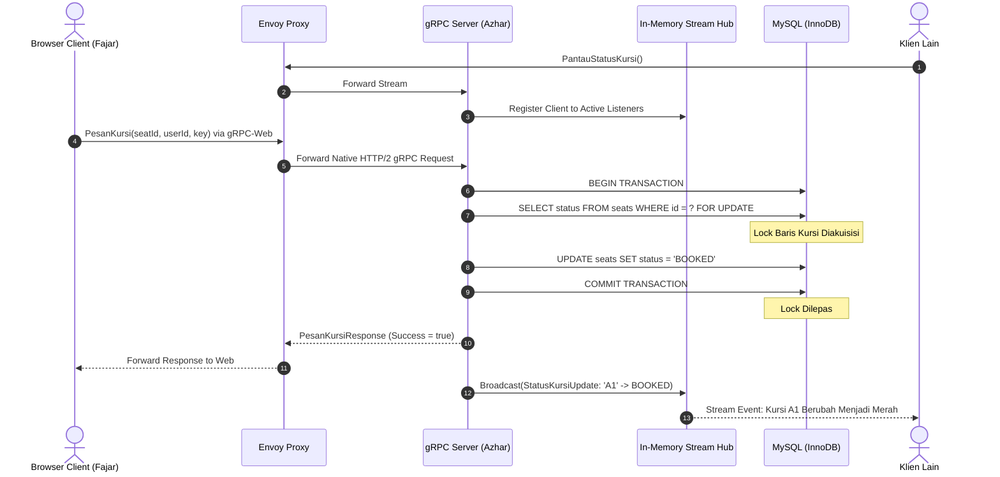

# System Design & Architecture — TIXO

> **Sistem Terdistribusi Reservasi Tiket Bioskop Real-Time Berbasis gRPC & gRPC-Web**  
> Penulis: Tim Proyek TIXO (Azhar, Fajar, Fasha)  
> Versi: 1.0.0

---

## 1. Topologi Arsitektur Terdistribusi

Sistem **TIXO** dirancang menggunakan arsitektur modular terdistribusi berbasis kontainer. Arsitektur ini memisahkan secara tegas antara lapisan presentasi (*Client*), reverse proxy penerjemah protokol (*Envoy*), pemroses logika bisnis & RPC (*Backend Server*), dan penyimpanan persisten ACID (*MySQL Database*).

```
+-------------------------------------------------------------------------------+
|                           BROWSER CLIENT (Fajar)                              |
|         React 18 + Vite + Tailwind CSS + grpc-web (TypeScript Client)         |
|        - Render 5x10 Seat Interactive Grid                                    |
|        - Real-Time Subscription via Server Streaming                          |
+-------------------------------------------------------------------------------+
                                      |
                                      | HTTP/1.1 (gRPC-Web Protocol / JSON/Protobuf)
                                      v
+-------------------------------------------------------------------------------+
|                            ENVOY PROXY (Fasha)                                |
|        - Port 8080 Listener (Inbound from Web)                                |
|        - Filter: envoy.filters.http.grpc_web                                  |
|        - Filter: envoy.filters.http.cors                                      |
|        - Translates HTTP/1.1 gRPC-Web to Native HTTP/2 gRPC                   |
+-------------------------------------------------------------------------------+
                                      |
                                      | Native gRPC over HTTP/2 (Port 50051)
                                      v
+-------------------------------------------------------------------------------+
|                          gRPC SERVER NODE.JS (Azhar)                          |
|        - TypeScript + @grpc/grpc-js Engine                                    |
|        - RPC Handlers: GetDaftarKursi, PesanKursi, PantauStatusKursi, Batal   |
|        - In-Memory Stream Hub (Event-Driven Broadcast)                        |
|        - Transactional Unit of Work & Idempotency Filter                      |
+-------------------------------------------------------------------------------+
                                      |
                                      | MySQL Binary Protocol (mysql2/promise)
                                      v
+-------------------------------------------------------------------------------+
|                             MYSQL DATABASE 8.0                                |
|        - Table: seats (id, seat_number, status, booked_by_user, updated_at)   |
|        - Table: idempotency_keys (key, user_id, seat_id, response, created_at)|
|        - Engine: InnoDB (Mendukung Row-Level Locking 'SELECT ... FOR UPDATE') |
+-------------------------------------------------------------------------------+
```

---

## 2. Definisi Kontrak Protocol Buffers (`proto/cinema.proto`)

Kontrak antarmuka layanan didefinisikan secara deklaratif menggunakan Protobuf versi 3. Kontrak ini menjadi acuan tunggal (*single source of truth*) bagi Backend, Frontend, dan skrip pengujian beban k6.

```protobuf
syntax = "proto3";

package cinema;

option go_package = "./pb";

// Service Definisi Bioskop TIXO
service CinemaService {
  // 1. Unary RPC: Mengambil seluruh daftar dan status kursi di suatu studio
  rpc GetDaftarKursi (GetDaftarKursiRequest) returns (GetDaftarKursiResponse);

  // 2. Unary RPC: Memesan kursi tertentu secara aman dan bebas race condition
  rpc PesanKursi (PesanKursiRequest) returns (PesanKursiResponse);

  // 3. Server Streaming RPC: Membuka channel stream untuk menerima update status kursi real-time
  rpc PantauStatusKursi (PantauStatusRequest) returns (stream StatusKursiUpdate);

  // 4. Unary RPC: Membatalkan pesanan kursi
  rpc BatalPesanan (BatalPesananRequest) returns (BatalPesananResponse);
}

// Status Kursi
enum SeatStatus {
  AVAILABLE = 0;   // Tersedia untuk dipesan
  PROCESSING = 1;  // Sedang dalam transaksi lock
  BOOKED = 2;      // Sudah resmi terpesan
}

// Entitas Kursi
message Seat {
  string seat_id = 1;          // Contoh: "A1", "B5"
  string seat_number = 2;      // Contoh: "A1"
  SeatStatus status = 3;       // Status saat ini
  string booked_by_user = 4;   // User ID pemesan (jika sudah booked)
}

// Request & Response: GetDaftarKursi
message GetDaftarKursiRequest {
  string studio_id = 1;        // ID Studio (misal: "std-01")
}

message GetDaftarKursiResponse {
  repeated Seat seats = 1;
}

// Request & Response: PesanKursi
message PesanKursiRequest {
  string studio_id = 1;
  string seat_id = 2;
  string user_id = 3;
  string idempotency_key = 4; // UUID v4 untuk mencegah eksekusi ganda
}

message PesanKursiResponse {
  bool success = 1;
  string message = 2;
  Seat updated_seat = 3;
  int64 timestamp = 4;
}

// Request & Stream Response: PantauStatusKursi
message PantauStatusRequest {
  string studio_id = 1;
  string client_id = 2;
}

message StatusKursiUpdate {
  string seat_id = 1;
  SeatStatus new_status = 2;
  string updated_by = 3;
  int64 timestamp = 4;
}

// Request & Response: BatalPesanan
message BatalPesananRequest {
  string studio_id = 1;
  string seat_id = 2;
  string user_id = 3;
  string idempotency_key = 4;
}

message BatalPesananResponse {
  bool success = 1;
  string message = 2;
  Seat updated_seat = 3;
}
```

---

## 3. Desain Skema Basis Data & Konkurensi (`database/init.sql`)

### 3.1 Skema Tabel MySQL
Basis data menggunakan engine **InnoDB** yang memiliki kemampuan isolasi transaksi ACID dan penguncian tingkat baris (*Row-Level Locking*).

```sql
CREATE DATABASE IF NOT EXISTS tixo_db;
USE tixo_db;

-- Tabel Kursi Bioskop
CREATE TABLE IF NOT EXISTS seats (
    id VARCHAR(32) PRIMARY KEY,
    studio_id VARCHAR(32) NOT NULL DEFAULT 'std-01',
    seat_number VARCHAR(10) NOT NULL,
    status ENUM('AVAILABLE', 'PROCESSING', 'BOOKED') NOT NULL DEFAULT 'AVAILABLE',
    booked_by_user VARCHAR(64) NULL,
    version INT NOT NULL DEFAULT 1,
    created_at TIMESTAMP DEFAULT CURRENT_TIMESTAMP,
    updated_at TIMESTAMP DEFAULT CURRENT_TIMESTAMP ON UPDATE CURRENT_TIMESTAMP,
    INDEX idx_studio_status (studio_id, status)
) ENGINE=InnoDB DEFAULT CHARSET=utf8mb4;

-- Tabel Kunci Idempotensi (Mencegah Duplicate Request / Replay Attacks)
CREATE TABLE IF NOT EXISTS idempotency_keys (
    idempotency_key VARCHAR(64) PRIMARY KEY,
    user_id VARCHAR(64) NOT NULL,
    seat_id VARCHAR(32) NOT NULL,
    response_payload JSON NOT NULL,
    created_at TIMESTAMP DEFAULT CURRENT_TIMESTAMP
) ENGINE=InnoDB DEFAULT CHARSET=utf8mb4;

-- Seeding Kursi Studio 1: 5 Baris (A-E) x 10 Kolom (1-10) = 50 Kursi
INSERT IGNORE INTO seats (id, studio_id, seat_number, status) VALUES
('A1','std-01','A1','AVAILABLE'),('A2','std-01','A2','AVAILABLE'),('A3','std-01','A3','AVAILABLE'),('A4','std-01','A4','AVAILABLE'),('A5','std-01','A5','AVAILABLE'),
('A6','std-01','A6','AVAILABLE'),('A7','std-01','A7','AVAILABLE'),('A8','std-01','A8','AVAILABLE'),('A9','std-01','A9','AVAILABLE'),('A10','std-01','A10','AVAILABLE'),
('B1','std-01','B1','AVAILABLE'),('B2','std-01','B2','AVAILABLE'),('B3','std-01','B3','AVAILABLE'),('B4','std-01','B4','AVAILABLE'),('B5','std-01','B5','AVAILABLE'),
('B6','std-01','B6','AVAILABLE'),('B7','std-01','B7','AVAILABLE'),('B8','std-01','B8','AVAILABLE'),('B9','std-01','B9','AVAILABLE'),('B10','std-01','B10','AVAILABLE'),
('C1','std-01','C1','AVAILABLE'),('C2','std-01','C2','AVAILABLE'),('C3','std-01','C3','AVAILABLE'),('C4','std-01','C4','AVAILABLE'),('C5','std-01','C5','AVAILABLE'),
('C6','std-01','C6','AVAILABLE'),('C7','std-01','C7','AVAILABLE'),('C8','std-01','C8','AVAILABLE'),('C9','std-01','C9','AVAILABLE'),('C10','std-01','C10','AVAILABLE'),
('D1','std-01','D1','AVAILABLE'),('D2','std-01','D2','AVAILABLE'),('D3','std-01','D3','AVAILABLE'),('D4','std-01','D4','AVAILABLE'),('D5','std-01','D5','AVAILABLE'),
('D6','std-01','D6','AVAILABLE'),('D7','std-01','D7','AVAILABLE'),('D8','std-01','D8','AVAILABLE'),('D9','std-01','D9','AVAILABLE'),('D10','std-01','D10','AVAILABLE'),
('E1','std-01','E1','AVAILABLE'),('E2','std-01','E2','AVAILABLE'),('E3','std-01','E3','AVAILABLE'),('E4','std-01','E4','AVAILABLE'),('E5','std-01','E5','AVAILABLE'),
('E6','std-01','E6','AVAILABLE'),('E7','std-01','E7','AVAILABLE'),('E8','std-01','E8','AVAILABLE'),('E9','std-01','E9','AVAILABLE'),('E10','std-01','E10','AVAILABLE');
```

---

## 4. Mekanisme Pencegahan Race Condition (`SELECT ... FOR UPDATE`)

### 4.1 Mengapa Harus Row-Level Locking?
Pada kondisi konkurensi tinggi, jika dua thread backend melakukan query `SELECT status FROM seats WHERE id = 'A1'` secara serentak, keduanya mungkin membaca status `AVAILABLE`. Keduanya kemudian menjalankan `UPDATE seats SET status = 'BOOKED'`. Akibatnya terjadi **Double Booking** (Korupsi Data).

Dengan menyertakan klausa `FOR UPDATE`:
1. Transaksi pertama yang mengeksekusi `SELECT ... FOR UPDATE` mendapatkan *Exclusive Lock* (X-Lock) atas baris tersebut.
2. Transaksi kedua yang mencoba mengakses baris tersebut akan **dihentikan sementara (*wait state*)** oleh engine InnoDB sampai transaksi pertama melakukan `COMMIT` atau `ROLLBACK`.
3. Saat transaksi kedua akhirnya mendapatkan giliran, baris tersebut telah berstatus `BOOKED`, sehingga transaksi kedua langsung gagal dengan pesan error aman.

### 4.2 Logika Transaksi di Backend Node.js
```typescript
import mysql from 'mysql2/promise';

export async function bookSeatWithLock(
  pool: mysql.Pool,
  studioId: string,
  seatId: string,
  userId: string,
  idempotencyKey: string
): Promise<{ success: boolean; message: string; seat?: any }> {
  const connection = await pool.getConnection();

  try {
    await connection.beginTransaction();

    // 1. Periksa Idempotency Key terlebih dahulu
    const [existing]: any = await connection.execute(
      'SELECT response_payload FROM idempotency_keys WHERE idempotency_key = ? FOR UPDATE',
      [idempotencyKey]
    );

    if (existing.length > 0) {
      await connection.commit();
      return JSON.parse(existing[0].response_payload);
    }

    // 2. Kunci baris kursi secara eksklusif (Row-Level Lock)
    const [rows]: any = await connection.execute(
      'SELECT id, studio_id, seat_number, status, booked_by_user FROM seats WHERE id = ? AND studio_id = ? FOR UPDATE',
      [seatId, studioId]
    );

    if (rows.length === 0) {
      await connection.rollback();
      return { success: false, message: 'Kursi tidak ditemukan.' };
    }

    const seat = rows[0];

    // 3. Validasi status ketersediaan kursi
    if (seat.status !== 'AVAILABLE') {
      await connection.rollback();
      return { 
        success: false, 
        message: `Kursi ${seat.seat_number} sudah dipesan oleh pengguna lain.` 
      };
    }

    // 4. Update data kursi menjadi BOOKED
    await connection.execute(
      'UPDATE seats SET status = "BOOKED", booked_by_user = ?, updated_at = NOW() WHERE id = ?',
      [userId, seatId]
    );

    const updatedSeat = {
      seat_id: seat.id,
      seat_number: seat.seat_number,
      status: 2, // BOOKED
      booked_by_user: userId
    };

    const responseData = {
      success: true,
      message: `Pemesanan kursi ${seat.seat_number} berhasil!`,
      seat: updatedSeat
    };

    // 5. Simpan jejak Idempotency Key
    await connection.execute(
      'INSERT INTO idempotency_keys (idempotency_key, user_id, seat_id, response_payload) VALUES (?, ?, ?, ?)',
      [idempotencyKey, userId, seatId, JSON.stringify(responseData)]
    );

    await connection.commit();
    return responseData;

  } catch (error) {
    await connection.rollback();
    throw error;
  } finally {
    connection.release();
  }
}
```

---

## 5. In-Memory Stream Hub (Server Streaming Real-Time Broadcast)

Ketika transaksi pemesanan atau pembatalan berhasil di-*commit* ke MySQL, perubahan status harus disiarkan ke seluruh web browser yang sedang membuka antarmuka bioskop.

Backend mengelola **Stream Manager (Hub)** berbasis `EventEmitter`:
1. Setiap klien yang memanggil `PantauStatusKursi` mendaftarkan objek `ServerWritableStream` ke daftar subscriber aktif studio.
2. Ketika fungsi mutasi sukses, server memicu pemanggilan `streamHub.broadcast(studioId, updatePayload)`.
3. Event loop mengirim frame data biner HTTP/2 ke setiap koneksi aktif.
4. Ketika klien menutup tab browser atau terjadi diskoneksi, listener otomatis dibersihkan untuk mencegah *memory leak*.

---

## 6. Diagram Alur Transaksi & Broadcast (Sequence Diagram)



---

## 7. Rencana Pengujian Konkurensi & Beban (k6 Simulation - Fasha)

Pengujian dilakukan menggunakan skrip **k6** yang mendukung koneksi native gRPC (`k6/net/grpc`).

### 7.1 Skenario Uji Beban
1. **Skenario 1 (Baseline - 1 VU):** Mengukur latensi dasar gRPC RPC tanpa ada perebutan sumber daya.
2. **Skenario 2 (Contention Rendah - 5 VUs):** 5 pengguna serentak menembak kursi yang persis sama di milidetik yang sama.
3. **Skenario 3 (Contention Tinggi - 20 VUs):** 20 pengguna virtual serentak berebut 1 kursi.

### 7.2 Tolok Ukur Keberhasilan Pengujian
* Hanya **1 request** yang menghasilkan respon `success: true`.
* **Semua request lainnya** menerima respon `success: false` dengan pesan kursi sudah terisi.
* Database tetap konsisten (nilai `status = 'BOOKED'` dengan `booked_by_user` dari VU yang menang).
* Tingkat kesalahan inkonsistensi data = **0%**.
